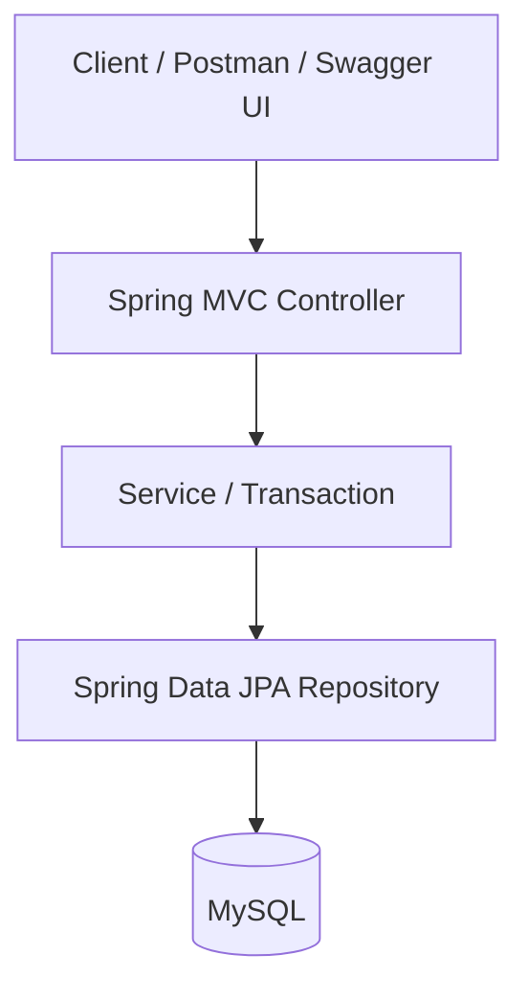
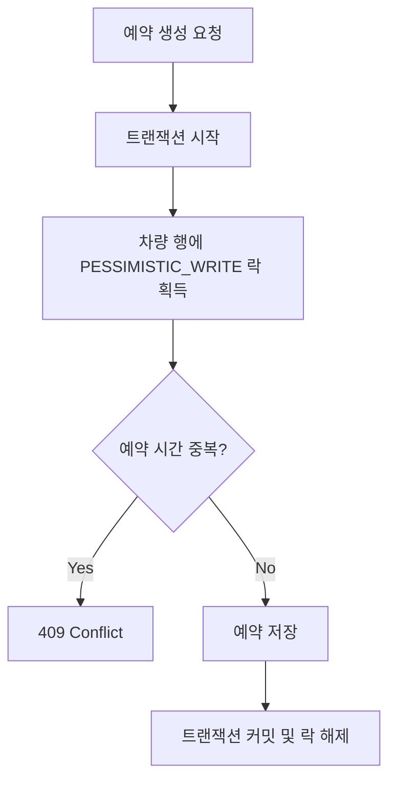

# Next-CCS

### Connected Car Core System

> 동시 예약 환경에서 데이터 정합성을 보장하고, 대용량 예약 데이터의 조회 성능을 개선하는 차량 예약 백엔드 프로젝트

Next-CCS는 차량 예약 시스템에서 발생할 수 있는 동시성 문제와 대용량 데이터 조회 병목을 직접 재현하고 해결하는 데 집중한 프로젝트입니다.

단순한 CRUD 구현을 넘어, 문제 재현 → 원인 분석 → 기술 선택 → 검증의 과정을 통해 백엔드 시스템의 안정성과 성능을 개선했습니다.

## 핵심 성과

| 구분 | 개선 내용 | 검증 결과 |
|---|---|---|
| 동시성 제어 | 비관적 락 기반 중복 예약 방지 | 10개 동시 요청 중 1건 성공, 9건 충돌 |
| 예약 조회 성능 | `(vehicle_id, start_time)` 복합 인덱스 적용 | 접근 행 100,000건 → 744건 |
| 인덱스 실행시간 | 단일 인덱스와 복합 인덱스 비교 | 중앙값 540.700ms → 1.717ms |
| 차량 목록 조회 | 페이지네이션 적용 | 응답 크기 951,690B → 2,191B |
| 자동화 테스트 | 동시성·예약 입력값·시간 경계·페이지네이션 검증 | JUnit 5 / MockMvc / Spring Boot Test 통과, 테스트 DB 분리 |

인덱스 성능 측정은 특정 차량에 예약 이력 100,000건을 구성한 로컬 MySQL 스트레스 시나리오에서 수행했습니다. 차량 목록 페이지네이션 측정은 차량 10,017대가 저장된 로컬 환경에서 수행했습니다. 각 측정의 조건과 한계는 아래 섹션에 별도로 명시했습니다.

---

## 기술 스택

| 구분 | 기술 |
|---|---|
| Language | Java 21 |
| Framework | Spring Boot 4.1.0 |
| Web | Spring MVC |
| ORM | Spring Data JPA / Hibernate |
| Database | MySQL 8 |
| API Documentation | Springdoc OpenAPI / Swagger UI |
| Build | Gradle |
| Testing | JUnit 5, Spring Boot Test |
| Version Control | Git / GitHub |

### 향후 확장 예정

- Redis 기반 캐싱 및 성능 비교
- Kafka 기반 비동기 이벤트 처리
- Docker 기반 실행 환경 구성
- 인증 및 권한 관리

위 항목은 현재 구현 완료된 기능이 아닌 향후 개선 계획입니다.

---

## 시스템 아키텍처



### 계층별 역할

- Controller: HTTP 요청 처리 및 DTO 응답
- Service: 예약 시간 검증, 중복 검사, 트랜잭션 처리
- Repository: JPA 기반 데이터 접근
- MySQL: 차량 및 예약 데이터 저장, 비관적 락과 인덱스 활용

---

## 주요 기능

### 1. 차량 관리

- 차량 등록
- 차량 단건 조회
- 차량 목록 페이지 조회
- 차량 번호 중복 검사
- 차량 상태 관리

### 2. 예약 관리

- 차량 예약 생성
- 예약 시작·종료 시간 유효성 검사
- 동일 차량의 시간 중복 예약 방지
- 차량별 기간 예약 조회
- 예약 결과 DTO 반환

### 3. 동시성 제어

동일 차량에 동시에 예약 요청이 들어오는 상황에서 발생하는 Race Condition을 재현했습니다.

예약 중복 여부를 검사하는 과정과 실제 예약을 저장하는 과정 사이에 다른 트랜잭션이 개입하면 중복 예약이 발생할 수 있습니다.

이를 해결하기 위해 예약 생성 트랜잭션에서 차량 행에 비관적 쓰기 락을 적용했습니다.

```java
@Lock(LockModeType.PESSIMISTIC_WRITE)
@Query("select v from Vehicle v where v.id = :id")
Optional<Vehicle> findByIdForUpdate(@Param("id") Long id);
```

예약 생성 흐름:



#### 동시성 테스트

Java `ExecutorService`, `CountDownLatch`, `AtomicInteger`를 이용하여 10개 스레드가 동일 차량과 시간에 예약을 시도하도록 구성했습니다.

| 결과 | 건수 |
|---|---:|
| 예약 성공 | 1 |
| 예약 충돌 | 9 |
| 예상치 못한 예외 | 0 |

동시 요청 10건에 대해 예약 성공 1건, 충돌 9건, 예상치 못한 예외 0건을 확인했습니다. 또한 테스트 종료 전 `countByVehicleId()`를 통해 해당 차량의 실제 DB 예약 건수가 1건임을 검증했습니다.

테스트는 별도의 MySQL 테스트 DB에서 수행했으며, `CountDownLatch`로 요청 시작 시점을 맞추고 각 작업 스레드에서 독립적으로 예약 생성 트랜잭션을 실행했습니다.

---

## 데이터베이스 성능 최적화

### 문제 정의

차량별 예약 이력을 기간 단위로 조회하는 API의 성능을 개선했습니다.

```sql
SELECT *
FROM reservation
WHERE vehicle_id = ?
  AND start_time >= ?
  AND start_time < ?;
```

### 테스트 환경

- 차량 약 10,000대
- 기본 예약 약 1,000,000건
- 별도 스트레스 테스트 차량에 예약 100,000건 구성
- 조회 대상 차량 ID: 20006
- 조회 기간: 2020년 1월
- 실제 반환 행: 744건

전체 데이터가 많더라도 차량별 예약이 균등하게 분포하면 기존 단일 인덱스만으로 충분히 조회 범위가 좁혀질 수 있었습니다.

따라서 특정 차량에 장기간 예약 이력이 누적된 스트레스 시나리오를 별도로 구성했습니다.

### Before: 단일 인덱스

기존 인덱스:

```sql
(vehicle_id)
```

실행계획:

```text
Index lookup
→ vehicle_id 조건으로 100,000행 접근
→ start_time 조건 필터링
→ 744행 반환
```

### After: 복합 인덱스

개선 인덱스:

```sql
CREATE INDEX idx_reservation_vehicle_start_time
ON reservation (vehicle_id, start_time);
```

실행계획:

```text
Index range scan
→ vehicle_id + start_time 조건으로 범위 탐색
→ 744행 접근
→ 744행 반환
```

### 성능 측정 결과

동일한 데이터와 조회 조건에서 각 인덱스를 `FORCE INDEX`로 지정하여 `EXPLAIN ANALYZE`를 3회씩 수행했습니다.

| 측정 | 단일 인덱스 | 복합 인덱스 |
|---|---:|---:|
| 1회 | 422.905ms | 1.509ms |
| 2회 | 900.461ms | 2.594ms |
| 3회 | 540.700ms | 1.717ms |
| 평균 | 621.355ms | 1.940ms |
| 중앙값 | 540.700ms | 1.717ms |

특정 차량에 예약 이력 100,000건이 집중된 스트레스 시나리오에서, 단일 인덱스는 차량별 예약 데이터를 조회한 뒤 기간 조건을 필터링했습니다. 반면 `(vehicle_id, start_time)` 복합 인덱스는 차량 ID와 기간 조건을 함께 이용한 범위 탐색을 수행했습니다.

`EXPLAIN ANALYZE`를 통한 비교에서 접근 대상 행 수가 약 100,000건에서 744건으로 감소했으며, 동일한 조건에서 3회 측정한 실행시간 중앙값은 540.700ms에서 1.717ms로 감소했습니다. 중앙값 기준 약 315배의 실행시간 차이가 관찰되었습니다.

다만 로컬 환경의 실행시간은 캐시, DB 상태, 하드웨어 등의 영향을 받습니다. 따라서 핵심 개선 근거는 실행계획과 접근 행 수의 감소에 두었습니다. 특히 특정 차량에 예약 이력이 집중된 스트레스 환경에서 관찰한 결과이므로, 일반적인 운영 환경에서도 동일한 성능 향상이 발생한다고 단정할 수 없습니다.


---

## 차량 목록 조회 페이지네이션

### 문제

초기 차량 목록 API는 `findAll()`을 사용하여 전체 차량을 반환했습니다.

차량 10,017대가 저장된 환경에서 전체 목록 조회 시 약 952KB의 JSON 응답이 발생했으며, Swagger UI에서 대량 응답을 표시하는 과정에 지연이 관찰되었습니다.

### 개선

Spring Data JPA의 `Pageable`을 이용하여 페이지 단위 조회를 구현했습니다.

- 기본 페이지 크기: 20
- 최대 페이지 크기: 100
- 정렬 기준: 차량 ID 오름차순
- 잘못된 페이지 번호 및 크기: HTTP 400 반환
- 페이지 메타데이터 제공: 전체 건수, 전체 페이지 수, 현재 페이지 번호

### 개선 전후 측정

| 지표 | 전체 조회 | 페이지 조회 |
|---|---:|---:|
| 반환 차량 수 | 10,017대 | 20대 |
| 전체 HTTP 응답시간 | 105.454ms | 24.174ms |
| 응답 크기 | 951,690B | 2,191B |

단일 로컬 측정에서 응답 크기는 약 99.77%, HTTP 응답시간은 약 77.1% 감소했습니다.

단, 각 방식은 한 번씩 측정했으며 반환 데이터량이 다릅니다. 따라서 DB 쿼리 자체가 77.1% 빨라졌다는 의미는 아닙니다.

### 검증

MockMvc 기반 테스트를 통해 페이지 번호, 페이지 크기, 페이지 메타데이터, 잘못된 요청에 대한 HTTP 400 응답을 검증했습니다.

추가로 테스트 전용 MySQL DB에 차량 25건을 생성하여 다음 항목을 확인했습니다.

- 첫 번째 페이지에 차량 20건 반환
- 두 번째 페이지에 차량 5건 반환
- 전체 데이터 25건 및 전체 페이지 2개 확인
- 차량 ID 기준 오름차순 정렬 확인
- 테스트 트랜잭션 롤백을 통한 테스트 데이터 정리
---

## API 명세

| Method | Endpoint | 설명 |
|---|---|---|
| POST | `/vehicles` | 차량 등록 |
| GET | `/vehicles/{id}` | 차량 단건 조회 |
| GET | `/vehicles?page=0&size=20` | 차량 목록 페이지 조회 |
| PATCH | `/vehicles/{id}/status` | 차량 상태 변경 |
| POST | `/reservations` | 예약 생성 |
| GET | `/reservations` | 차량별 기간 예약 조회 |
예약 기간 조회 API는 `vehicleId`, `startTime`, `endTime`을 쿼리 파라미터로 받으며, 예약 시작 시간이 `[startTime, endTime)` 범위에 포함되는 예약을 반환합니다.


### 예약 생성 응답

| HTTP 상태 코드 | 의미 |
|---|---|
| 201 Created | 예약 생성 성공 |
| 400 Bad Request | 필수 입력값 누락 또는 잘못된 예약 시간 |
| 404 Not Found | 존재하지 않는 차량 |
| 409 Conflict | 기존 예약과 시간 충돌 |

예약 생성 요청은 `@Valid`를 이용해 필수 입력값을 검증하며, Service 계층에서도 시작 시간과 종료 시간의 유효성을 확인합니다.

### 차량 목록 조회 예시

```http
GET /vehicles?page=0&size=20
```

### 예약 생성 예시

```http
POST /reservations
Content-Type: application/json
```

```json
{
  "vehicleId": 1,
  "startTime": "2031-01-10T10:00:00",
  "endTime": "2031-01-10T12:00:00"
}
```

### Swagger UI

애플리케이션 실행 후 아래 주소에서 API를 확인할 수 있습니다.

http://localhost:8080/swagger-ui/index.html


---

## 실행 방법

### 사전 요구사항

- JDK 21
- MySQL 8
- Git

### 1. 프로젝트 다운로드

```bash
git clone https://github.com/sombackend-dev/next-ccs.git
cd next-ccs
```

### 2. 데이터베이스 생성

MySQL에서 다음 SQL을 실행합니다.

```sql
CREATE DATABASE IF NOT EXISTS next_ccs;
```

### 3. 환경 변수 설정

애플리케이션 실행 전에 다음 환경 변수를 등록합니다.

| 환경 변수 | 설명 |
|---|---|
| `DB_USERNAME` | MySQL 사용자 이름 |
| `DB_PASSWORD` | MySQL 비밀번호 |

`application.properties`는 다음과 같이 환경 변수를 참조합니다.

```properties
spring.datasource.url=jdbc:mysql://localhost:3306/next_ccs?serverTimezone=Asia/Seoul&characterEncoding=UTF-8
spring.datasource.username=${DB_USERNAME}
spring.datasource.password=${DB_PASSWORD}
```

실제 데이터베이스 비밀번호는 소스코드에 저장하지 않습니다.

현재 프로젝트는 로컬 개발 환경에서 Hibernate의 `ddl-auto=update`를 사용합니다. 운영 환경에서는 Flyway 등 별도의 스키마 마이그레이션 도구를 사용하는 방향을 검토하고 있습니다.

### 4. 애플리케이션 실행

Windows:

```powershell
.\gradlew.bat bootRun
```

macOS / Linux:

```bash
./gradlew bootRun
```

서버 실행 후 다음 주소에서 Swagger UI에 접근할 수 있습니다.

http://localhost:8080/swagger-ui/index.html

### 5. 테스트 실행

테스트 환경은 개발용 DB(`next_ccs`)와 분리된 MySQL DB(`next_ccs_test`)를 사용합니다.

먼저 MySQL에서 테스트 전용 데이터베이스를 생성합니다.

```sql
CREATE DATABASE IF NOT EXISTS next_ccs_test
CHARACTER SET utf8mb4
COLLATE utf8mb4_0900_ai_ci;
```

테스트 DB에 접근할 수 있는 MySQL 계정과 `DB_USERNAME`, `DB_PASSWORD` 환경 변수가 필요합니다.

Spring Boot 통합 테스트에는 `@ActiveProfiles("test")`를 적용하고, `src/test/resources/application-test.properties`에서 테스트 전용 DB에 연결하도록 설정했습니다.

테스트 환경의 `spring.jpa.hibernate.ddl-auto=create-drop`은 테스트 스키마를 생성하고 제거하므로, 테스트 DB에는 보존해야 할 데이터를 저장하지 않아야 합니다.

Windows:

```powershell
.\gradlew.bat clean test
```

macOS / Linux:

```bash
./gradlew clean test
```

테스트에는 예약 입력 검증, 예약 시간 유효성 검사, 차량 목록 페이지네이션 등이 포함됩니다.

---

## 개발 기록

프로젝트 구현 과정과 기술적 의사결정은 다음 문서에 기록했습니다.

- [개발 일지](docs/Development_Log.md)
- [DB 인덱스 성능 분석](docs/learning/12_Database_Index_Performance.md)

주요 학습 및 검증 주제:

- Spring Boot 계층형 아키텍처
- JPA 엔티티 및 DTO 설계
- 트랜잭션과 비관적 락
- 동시 예약 충돌 재현 및 해결
- MySQL 실행계획 분석
- 복합 인덱스 최적화
- Spring Data JPA 페이지네이션
- MockMvc 기반 API 테스트

---

## 현재 개발 상태

### 구현 완료

- [x] 차량 등록 및 단건 조회
- [x] 차량 번호 중복 검증
- [x] 차량 상태 변경
- [x] 예약 생성 및 시간 유효성 검사
- [x] 예약 시간 중복 방지
- [x] 비관적 락 기반 동시성 제어
- [x] 10개 스레드 동시성 테스트
- [x] 대용량 예약 데이터 성능 실험
- [x] 복합 인덱스 기반 예약 조회 최적화
- [x] 차량별 기간 예약 조회 API
- [x] 차량 목록 페이지네이션
- [x] 페이지네이션 요청 검증 및 자동화 테스트
- [x] Swagger API 문서화
- [x] DB 접속 정보 환경 변수 분리
- [x] README 작성
- [x] 테스트 전용 MySQL DB 구성 및 Spring 테스트 프로필 분리
- [x] 예약 요청 입력값 검증 및 HTTP 오류 응답 테스트
- [x] 예약 시간 유효성 검사 단위 테스트
- [x] 실제 데이터 기반 페이지네이션 결과 및 정렬 검증
- [x] 차량·예약 필수 컬럼의 DB NOT NULL 제약조건 적용
- [x] 동시성 테스트의 실제 DB 예약 건수 검증
- [x] 예약 조회 시작·종료 시간 경계 조건 테스트
- [x] 테스트 데이터 정리 및 트랜잭션 롤백 적용

### 향후 개선 과제

- [ ] DB 스키마 마이그레이션 도구 도입
- [ ] Docker 기반 실행 환경 구성
- [ ] Redis 캐싱 및 성능 비교
- [ ] Kafka 기반 비동기 이벤트 처리
- [ ] 인증 및 권한 관리

---

## 프로젝트를 통해 배운 점

### 1. 동시성 문제는 직접 재현하고 검증해야 한다

단순히 예약 중복 여부를 확인하는 것만으로는 동시에 들어오는 요청의 데이터 정합성을 보장할 수 없었습니다.

공유 차량 행에 비관적 락을 적용하고, 다중 스레드 테스트를 통해 중복 예약 방지 동작을 검증했습니다.

### 2. 인덱스 최적화에는 데이터 분포를 고려해야 한다

전체 데이터가 많다는 사실만으로 조회 병목이 발생하는 것은 아니었습니다.

특정 차량에 예약 이력이 집중된 환경을 구성하고 실행계획을 비교하여 복합 인덱스의 효과를 확인했습니다.

### 3. API 성능에는 응답 데이터 크기도 중요하다

전체 차량 조회 API는 서버에서 빠르게 응답하더라도 대량의 JSON을 전송하고 화면에 표시하는 부담이 있었습니다.

페이지네이션을 적용해 요청당 반환 데이터량을 제한하고 응답 크기를 줄였습니다.

### 4. 성능 개선 결과는 측정 조건과 함께 설명해야 한다

단일 측정값이나 특정 스트레스 환경의 결과를 모든 운영 환경에 일반화할 수는 없습니다.

실행계획, 접근 행 수, 응답 크기, 측정 환경을 함께 기록하여 개선 효과와 한계를 구분했습니다.