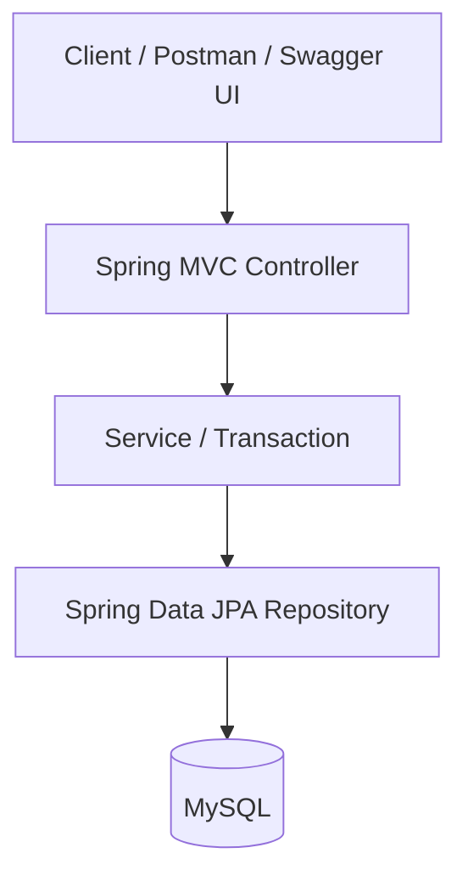
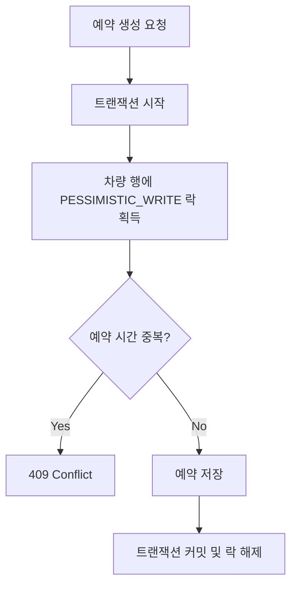

# Next-CCS

### Connected Car Core System

> 동시 예약 환경에서 데이터 정합성을 보장하고, 대용량 예약 데이터의 조회 성능을 개선하는 차량 예약 백엔드 프로젝트

Next-CCS는 차량 예약 시스템에서 발생할 수 있는 동시성 문제와 대용량 데이터 조회 병목을 직접 재현하고 해결하는 데 집중한 프로젝트입니다.

단순한 CRUD 구현을 넘어, 문제 재현 → 원인 분석 → 기술 선택 → 검증의 과정을 통해 백엔드 시스템의 안정성과 성능을 개선했습니다.

## 핵심 성과

| 구분 | 개선 내용 | 검증 결과 |
|---|---|---|
| 동시성 제어 | 비관적 락 기반 중복 예약 방지 | 동일 차량·시간 10개 동시 요청 중 1건 성공, 9건 충돌 |
| 조회 성능 | `(vehicle_id, start_time)` 복합 인덱스 적용 | 조회 후보 행 100,000건 → 744건 |
| 실행시간 | 단일 인덱스와 복합 인덱스 비교 | 중앙값 540.700ms → 1.717ms |
| 자동 테스트 | JUnit 기반 동시성 및 예약 조회 검증 | Gradle 전체 테스트 통과 |

성능 수치는 로컬 MySQL 환경에서 특정 차량에 예약 이력 100,000건을 구성한 스트레스 시나리오의 측정 결과입니다. 일반적인 운영 환경에서 동일한 성능 향상을 보장하지 않습니다.

---

## 기술 스택

| 구분 | 기술 |
|---|---|
| Language | Java 21 |
| Framework | Spring Boot 4.1.0 |
| Web | Spring MVC |
| ORM | Spring Data JPA / Hibernate |
| Database | MySQL 8 |
| API Documentation | Springdoc OpenAPI / Swagger UI |
| Build | Gradle |
| Testing | JUnit 5, Spring Boot Test |
| Version Control | Git / GitHub |

### 향후 확장 예정

- Redis 기반 캐싱 및 성능 비교
- Kafka 기반 비동기 이벤트 처리
- Docker 기반 실행 환경 구성
- 인증 및 권한 관리

위 항목은 현재 구현 완료된 기능이 아닌 향후 개선 계획입니다.

---

## 시스템 아키텍처



### 계층별 역할

- Controller: HTTP 요청 처리 및 DTO 응답
- Service: 예약 시간 검증, 중복 검사, 트랜잭션 처리
- Repository: JPA 기반 데이터 접근
- MySQL: 차량 및 예약 데이터 저장, 비관적 락과 인덱스 활용

---

## 주요 기능

### 1. 차량 관리

- 차량 등록
- 차량 단건 조회
- 전체 차량 조회
- 차량 번호 중복 검사
- 차량 상태 관리

### 2. 예약 관리

- 차량 예약 생성
- 예약 시작·종료 시간 유효성 검사
- 동일 차량의 시간 중복 예약 방지
- 차량별 기간 예약 조회
- 예약 결과 DTO 반환

### 3. 동시성 제어

동일 차량에 동시에 예약 요청이 들어오는 상황에서 발생하는 Race Condition을 재현했습니다.

예약 중복 여부를 검사하는 과정과 실제 예약을 저장하는 과정 사이에 다른 트랜잭션이 개입하면 중복 예약이 발생할 수 있습니다.

이를 해결하기 위해 예약 생성 트랜잭션에서 차량 행에 비관적 쓰기 락을 적용했습니다.

```java
@Lock(LockModeType.PESSIMISTIC_WRITE)
@Query("select v from Vehicle v where v.id = :id")
Optional<Vehicle> findByIdForUpdate(@Param("id") Long id);
```

예약 생성 흐름:



#### 동시성 테스트

Java `ExecutorService`, `CountDownLatch`, `AtomicInteger`를 이용하여 10개 스레드가 동일 차량과 시간에 예약을 시도하도록 구성했습니다.

| 결과 | 건수 |
|---|---:|
| 예약 성공 | 1 |
| 예약 충돌 | 9 |
| 예상치 못한 예외 | 0 |

동시 요청 상황에서 하나의 예약만 성공하도록 제어되는 것을 확인했습니다.

---

## 데이터베이스 성능 최적화

### 문제 정의

차량별 예약 이력을 기간 단위로 조회하는 API의 성능을 개선했습니다.

```sql
SELECT *
FROM reservation
WHERE vehicle_id = ?
  AND start_time >= ?
  AND start_time < ?;
```

### 테스트 환경

- 차량 약 10,000대
- 기본 예약 약 1,000,000건
- 별도 스트레스 테스트 차량에 예약 100,000건 구성
- 조회 대상 차량 ID: 20006
- 조회 기간: 2020년 1월
- 실제 반환 행: 744건

전체 데이터가 많더라도 차량별 예약이 균등하게 분포하면 기존 단일 인덱스만으로 충분히 조회 범위가 좁혀질 수 있었습니다.

따라서 특정 차량에 장기간 예약 이력이 누적된 스트레스 시나리오를 별도로 구성했습니다.

### Before: 단일 인덱스

기존 인덱스:

```sql
(vehicle_id)
```

실행계획:

```text
Index lookup
→ vehicle_id 조건으로 100,000행 접근
→ start_time 조건 필터링
→ 744행 반환
```

### After: 복합 인덱스

개선 인덱스:

```sql
CREATE INDEX idx_reservation_vehicle_start_time
ON reservation (vehicle_id, start_time);
```

실행계획:

```text
Index range scan
→ vehicle_id + start_time 조건으로 범위 탐색
→ 744행 접근
→ 744행 반환
```

### 성능 측정 결과

동일한 데이터와 조회 조건에서 각 인덱스를 `FORCE INDEX`로 지정하여 `EXPLAIN ANALYZE`를 3회씩 수행했습니다.

| 측정 | 단일 인덱스 | 복합 인덱스 |
|---|---:|---:|
| 1회 | 422.905ms | 1.509ms |
| 2회 | 900.461ms | 2.594ms |
| 3회 | 540.700ms | 1.717ms |
| 평균 | 621.355ms | 1.940ms |
| 중앙값 | 540.700ms | 1.717ms |

중앙값 기준 약 315배의 실행시간 차이가 관찰되었습니다.

다만 로컬 환경의 실행시간은 캐시, DB 상태, 하드웨어 등의 영향을 받으므로 핵심 개선 근거는 실행계획과 접근 행 수